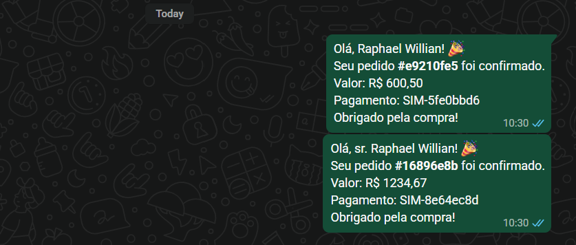
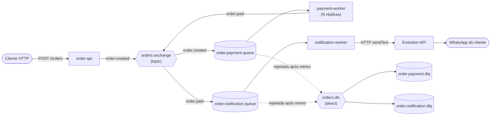
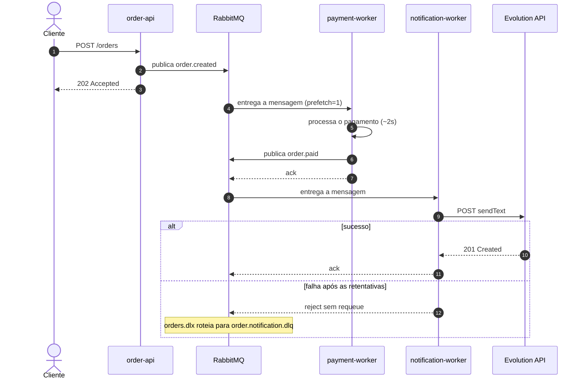
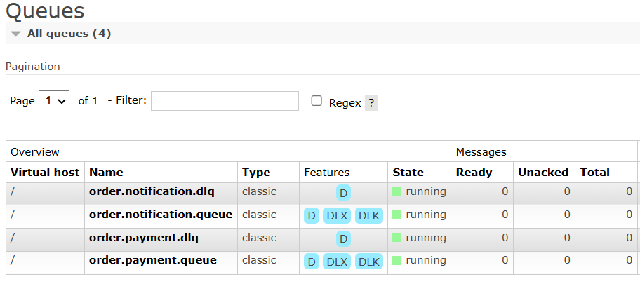
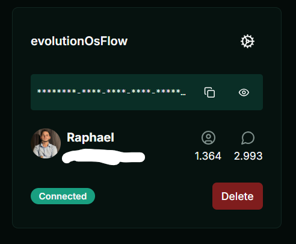
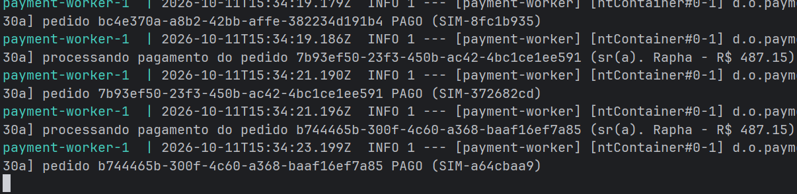

<div align="center">

# OrderFlow

**Pipeline assíncrono de pedidos com RabbitMQ, Spring Boot e notificações reais por WhatsApp (Evolution API).**


<br>



<sub>Do <code>POST /orders</code> à mensagem no WhatsApp, tudo orquestrado por filas.</sub>

</div>

---

## Sumário

- [Visão geral](#visão-geral)
- [Destaques](#destaques)
- [Arquitetura](#arquitetura)
- [Conceitos de mensageria aplicados](#conceitos-de-mensageria-aplicados)
- [Stack](#stack)
- [Estrutura do projeto](#estrutura-do-projeto)
- [Como executar](#como-executar)
- [Uso da API](#uso-da-api)
- [Cenários de demonstração](#cenários-de-demonstração)
- [Configuração](#configuração)
- [Decisões de projeto](#decisões-de-projeto)
- [Limitações e próximos passos](#limitações-e-próximos-passos)
- [Solução de problemas](#solução-de-problemas)
- [Referências](#referências)
- [Autor](#autor)
- [Licença](#licença)

---

## Visão geral

O **OrderFlow** simula o back-end de uma loja. A API recebe o pedido e responde na hora (`202 Accepted`). O restante do trabalho, que é cobrar e avisar o cliente, acontece em segundo plano, em serviços independentes ligados por filas do RabbitMQ.

**Problema que ele resolve:** cobrar e chamar APIs externas dentro da requisição HTTP deixa o sistema lento e frágil. Se o gateway demora ou o provedor de mensagens cai, o cliente fica esperando ou o pedido se perde. Com mensageria, cada etapa roda no seu ritmo, escala sozinha e falha de forma isolada e recuperável.

Tudo sobe com um único `docker compose up`, inclusive a Evolution API (WhatsApp), com PostgreSQL e Redis.

> [!NOTE]
> O gateway de pagamento suporta dois modos: **simulado** (`mock`, com latência e regra de recusa fixas) e **real** (`mercadopago`, integração com o Mercado Pago via `PaymentGatewayFactory`). O envio de WhatsApp é **real**, via Evolution API.

## Destaques

- **Respostas rápidas:** a API só valida, publica o evento e devolve `202`.
- **Escalabilidade horizontal:** réplicas do `payment-worker` dividem a mesma fila (competing consumers).
- **Resiliência:** retry com backoff exponencial e **Dead Letter Queue** em cada etapa, sem loops infinitos de reentrega.
- **Integração real com serviço externo:** WhatsApp via Evolution API, com timeouts configurados.
- **Desacoplamento temporal:** com um worker fora do ar, os pedidos continuam sendo aceitos e são processados quando ele volta.
- **Contrato de eventos compartilhado:** records Java em um módulo `common`, usados por todos os serviços.
- **Maven multi-módulo** e **Dockerfile multi-stage** (um só para os três serviços), sem precisar de Java ou Maven na máquina.
- **Segredos fora do Git:** configuração via `.env`, com `.env.example` versionado.

## Arquitetura

### Visão geral do fluxo



### Ciclo de vida de um pedido



### Topologia no RabbitMQ

| Fila | Binding (routing key) | Consumidor | Em caso de falha |
|---|---|---|---|
| `order.payment.queue` | `order.created` | `payment-worker` | Retry com backoff (`max-retries=2`, 1s ×2) e depois `order.payment.dlq` |
| `order.notification.queue` | `order.paid` | `notification-worker` | Retry com backoff (`max-retries=3`, 2s ×2) e depois `order.notification.dlq` |
| `order.payment.dlq` | `orders.dlx` com a key `order.payment.dlq` | Inspeção manual | n/a |
| `order.notification.dlq` | `orders.dlx` com a key `order.notification.dlq` | Inspeção manual | n/a |

Exchanges: `orders.exchange` (**topic**, durável) e `orders.dlx` (**direct**, durável).

<p align="center">
  
  <br>
  <sub>Painel do RabbitMQ (<code>localhost:15672</code>): as filas principais e suas dead-letter queues.</sub>
</p>

## Conceitos de mensageria aplicados

| Conceito | Como aparece no projeto | Onde ver |
|---|---|---|
| Producer / Consumer | A API publica, e os workers consomem | [`OrderController`](order-api/src/main/java/com/orderflow/api/OrderController.java), [`PaymentConsumer`](payment-worker/src/main/java/com/orderflow/payment/PaymentConsumer.java), [`NotificationConsumer`](notification-worker/src/main/java/com/orderflow/notification/NotificationConsumer.java) |
| Topic exchange e routing keys | `orders.exchange` roteia `order.created` e `order.paid` para filas diferentes | [`RabbitTopology`](common/src/main/java/com/orderflow/common/RabbitTopology.java) |
| Work queue (competing consumers) | Várias réplicas do `payment-worker` consomem a mesma fila | Cenário 2 |
| Fair dispatch | `prefetch=1`: o worker só recebe a próxima mensagem ao terminar a atual | `application.properties` dos workers |
| Ack / nack | Ack após o método retornar. Exceção leva a retry e depois a rejeição | `application.properties` dos workers |
| Retry com backoff | Retentativas com intervalo crescente antes de desistir | `application.properties` dos workers |
| Dead Letter Exchange / Queue | Mensagens rejeitadas vão para `orders.dlx` e depois para a DLQ da etapa | [`RabbitTopology`](common/src/main/java/com/orderflow/common/RabbitTopology.java) |
| Durabilidade | Filas e exchanges duráveis, mensagens persistentes (padrão do Spring AMQP) | Cenário 5 |
| Contrato de eventos | Records compartilhados, serializados em JSON | [`common`](common/src/main/java/com/orderflow/common) |
| Resiliência com API externa | Timeouts, retry e DLQ em torno da Evolution API | [`EvolutionClient`](notification-worker/src/main/java/com/orderflow/notification/EvolutionClient.java) |

## Stack

| Camada | Tecnologia |
|---|---|
| Linguagem | Java 21 |
| Framework | Spring Boot 4.1 (Spring AMQP 4, Spring Web MVC, Bean Validation) |
| Mensageria | RabbitMQ 3.13 (com Management UI) |
| WhatsApp | Evolution API v2.3.7 (Baileys), PostgreSQL 15 e Redis 7 |
| Build | Maven multi-módulo |
| Containers | Docker e Docker Compose (build multi-stage) |

## Estrutura do projeto

```
orderflow/
├── common/                 # contrato: eventos (records) e topologia do RabbitMQ
├── order-api/              # API REST: valida e publica order.created
├── payment-worker/         # consome order.created, "cobra" e publica order.paid
├── notification-worker/    # consome order.paid e envia WhatsApp (Evolution API)
├── docs/images/            # imagens do README
├── Dockerfile              # build multi-stage compartilhado (ARG MODULE)
├── docker-compose.yml      # RabbitMQ + Evolution API (+ Postgres, Redis) + serviços
├── .env.example            # modelo de configuração (copie para .env)
└── pom.xml                 # POM pai (multi-módulo)
```

## Front de retorno (estático)

O projeto inclui um front estático, disponibilizado separadamente e **não versionado neste repositório**, com o único propósito de atender às `back_urls` do Mercado Pago (`/success`, `/failure`, `/pending`). Ele é entregue ao navegador do comprador após o checkout e **não se comunica dinamicamente com o backend**: não consome APIs, não expõe rotas internas, não guarda access tokens e não lida com dados sensíveis. Sua função é exclusivamente exibir o retorno visual da transação, sendo a validação definitiva do pagamento feita exclusivamente no backend via webhook do Mercado Pago.


### Pré-requisitos

- Docker Engine 24+ e Docker Compose v2 (comando `docker compose`)
- Portas livres: `8080`, `8081`, `5672` e `15672`
- Cerca de 4 GB de RAM livres para os contêineres
- Um WhatsApp para conectar (**use um número secundário**) e outro número para receber as mensagens

> Não é necessário ter Java nem Maven instalados: o build acontece dentro do Docker.

### 1. Clonar e configurar

```bash
git clone https://github.com/Raphael-Willian/order-flow-rabbitmq.git
cd orderflow
cp .env.example .env
```

Edite o `.env` e defina `EVOLUTION_API_KEY` com uma chave aleatória (por exemplo, `openssl rand -hex 24`).

### 2. Subir a stack

```bash
docker compose up -d --build
docker compose ps
```

A primeira execução demora alguns minutos (download das imagens e build dos módulos).

### 3. Criar a instância do WhatsApp

```bash
set -a; source .env; set +a

curl -s -X POST "http://localhost:8081/instance/create" \
  -H "apikey: $EVOLUTION_API_KEY" -H "Content-Type: application/json" \
  -d "{\"instanceName\":\"$EVOLUTION_INSTANCE\",\"integration\":\"WHATSAPP-BAILEYS\",\"qrcode\":true}"
```

### 4. Conectar o número (QR code)

Abra o **Evolution Manager** em <http://localhost:8081/manager>. Entre com a URL `http://localhost:8081` e a sua `EVOLUTION_API_KEY`, abra a instância e escaneie o QR no celular, em **WhatsApp → Aparelhos conectados → Conectar um aparelho**.

<p align="center">
  
  <br>
  <sub>Instância conectada no Evolution Manager. A sessão fica salva em volume Docker: o QR é escaneado uma única vez.</sub>
</p>

Confirme a conexão (deve retornar `"state":"open"`):

```bash
curl -s "http://localhost:8081/instance/connectionState/$EVOLUTION_INSTANCE" -H "apikey: $EVOLUTION_API_KEY"
```

> [!WARNING]
> A Evolution API com `WHATSAPP-BAILEYS` é uma integração **não oficial** (emula o WhatsApp Web). Há risco de bloqueio do número. Use um número de teste, poucas mensagens e destinatários que concordam em recebê-las.

### 5. Fazer o primeiro pedido

```bash
curl -X POST http://localhost:8080/orders \
  -H "Content-Type: application/json" \
  -d '{"customer":"Ana Souza","phone":"5511999999999","amount":150.50}'
```

Em cerca de 2 segundos a mensagem chega no WhatsApp do número informado.

## Uso da API

| Método | Endpoint | Descrição | Resposta |
|---|---|---|---|
| `POST` | `/orders` | Cria um pedido e publica `order.created` | `202 Accepted` com o evento criado |
| `POST` | `/orders/bulk?count=12` | Gera N pedidos **sem telefone** (1 a 100) para demonstrar o consumo paralelo, sem enviar WhatsApp | `202 Accepted` com `{"published": N}` |

**Corpo de `POST /orders`**

| Campo | Tipo | Regra |
|---|---|---|
| `customer` | string | Obrigatório e não vazio |
| `phone` | string | Obrigatório. Só dígitos, DDI+DDD+número (12 ou 13 dígitos), por exemplo `5511999999999` |
| `amount` | number | Obrigatório e maior ou igual a `0.01` |

**Resposta (`202 Accepted`)**

```json
{
  "orderId": "3f2b8c1e-6d1a-4c52-9a43-0f7f6b1d2e9a",
  "customer": "Ana Souza",
  "phone": "5511999999999",
  "amount": 150.50
}
```

Corpos inválidos retornam `400 Bad Request`.

**Regra de negócio simulada:** pedidos com `amount` acima de **R$ 5.000** são recusados pelo `payment-worker` e terminam na `order.payment.dlq`.

## Cenários de demonstração

Cada cenário mostra um conceito de mensageria na prática. Acompanhe os logs com `docker compose logs -f payment-worker notification-worker` e o painel do RabbitMQ em <http://localhost:15672> (usuário e senha do `.env`).

### 1. Fluxo completo

```bash
curl -X POST http://localhost:8080/orders -H "Content-Type: application/json" \
  -d '{"customer":"Ana Souza","phone":"5511999999999","amount":150.50}'
```

**Observe:** a API responde de imediato. O pagamento fecha em cerca de 2s e a mensagem chega no WhatsApp.

### 2. Work queue: várias réplicas dividindo a fila

```bash
docker compose up -d --scale payment-worker=3
curl -X POST "http://localhost:8080/orders/bulk?count=12"
docker compose logs -f payment-worker
```

**Observe:** os 12 pedidos se dividem entre `payment-worker-1`, `-2` e `-3`. Cada réplica processa **um pedido por vez** (`prefetch=1`), sem acumular trabalho enquanto outra fica ociosa.

<p align="center">
  
  <br>
  <sub>Três réplicas do <code>payment-worker</code> consumindo a mesma fila em paralelo.</sub>
</p>

### 3. Retry com backoff e Dead Letter Queue (pagamento)

```bash
curl -X POST http://localhost:8080/orders -H "Content-Type: application/json" \
  -d '{"customer":"Ana Souza","phone":"5511999999999","amount":9999}'
```

**Observe:** os logs mostram as tentativas com intervalo crescente. Depois disso, `order.payment.dlq` fica com 1 mensagem. No painel, abra a fila e use **Get messages** com *Nack message requeue true* para inspecionar o payload sem consumi-lo.

### 4. Falha de serviço externo (notificação)

```bash
docker compose stop evolution-api
curl -X POST http://localhost:8080/orders -H "Content-Type: application/json" \
  -d '{"customer":"Bia Lima","phone":"5511999999999","amount":80}'
# o pagamento conclui, a notificação falha, é retentada e vai para order.notification.dlq
docker compose start evolution-api
```

**Observe:** o cliente já recebeu `202` e o pagamento foi concluído. A falha ficou isolada na etapa de notificação e a mensagem foi preservada na DLQ.

### 5. Desacoplamento e durabilidade

```bash
docker compose stop notification-worker
curl -X POST http://localhost:8080/orders -H "Content-Type: application/json" \
  -d '{"customer":"Caio Dias","phone":"5511999999999","amount":60}'
# painel: order.notification.queue com 1 mensagem em "Ready"
docker compose start notification-worker
```

**Observe:** com o consumidor parado, a mensagem espera na fila. Ao voltar, o worker a entrega, sem perda.

## Configuração

### Variáveis de ambiente (`.env`)

| Variável | Usada por | Descrição |
|---|---|---|
| `RABBITMQ_USER` | RabbitMQ e serviços | Usuário do broker |
| `RABBITMQ_PASSWORD` | RabbitMQ e serviços | Senha do broker |
| `EVOLUTION_API_KEY` | Evolution API e `notification-worker` | Chave global enviada no header `apikey` |
| `EVOLUTION_DB_PASSWORD` | Evolution API e PostgreSQL | Senha do banco da Evolution (**apenas letras e números**, pois vai dentro de uma URL) |
| `EVOLUTION_INSTANCE` | `notification-worker` | Nome da instância do WhatsApp usada no envio |
| `MERCADO_PAGO_ACCESS_TOKEN` | `payment-worker` | Token de acesso do Mercado Pago (obrigatório se `PAYMENT_PROVIDER=mercadopago`) |
| `MERCADO_PAGO_BASE_URL` | `payment-worker` | URL base da API do Mercado Pago (padrão: `https://api.mercadopago.com`) |
| `MERCADO_PAGO_CHECKOUT_MODE` | `payment-worker` | Modo do checkout: `redirect` ou `modal` (padrão: `redirect`) |

Também são definidas pelo `docker-compose.yml`: `RABBITMQ_HOST` (`rabbitmq`) e `EVOLUTION_BASE_URL` (`http://evolution-api:8080`).

### Portas

| Serviço | Porta no host | Acesso |
|---|---|---|
| `order-api` | 8080 | <http://localhost:8080> |
| RabbitMQ (AMQP) | 5672 | n/a |
| RabbitMQ Management | 15672 | <http://localhost:15672> |
| Evolution API e Manager | 8081 | <http://localhost:8081/manager> |

### Parâmetros de resiliência

| Parâmetro | Valor | Onde |
|---|---|---|
| `prefetch` | `1` | `application.properties` dos workers |
| `default-requeue-rejected` | `false` | `application.properties` dos workers |
| Retry do pagamento | `max-retries=2`, intervalo inicial `1s`, multiplicador `2` | `payment-worker` |
| Retry da notificação | `max-retries=3`, intervalo inicial `2s`, multiplicador `2` | `notification-worker` |
| Timeouts da Evolution API | conexão `5s`, leitura `15s` | [`EvolutionClient`](notification-worker/src/main/java/com/orderflow/notification/EvolutionClient.java) |
| Limite de pagamento simulado | R$ 5.000 | [`PaymentConsumer`](payment-worker/src/main/java/com/orderflow/payment/PaymentConsumer.java) |

## Decisões de projeto

- **Topic exchange:** novos consumidores (auditoria, analytics) podem ser ligados com um novo binding, sem alterar o produtor.
- **Workers separados:** pagamento e notificação escalam e falham de forma independente. O worker de pagamento nem tem cliente HTTP no classpath.
- **Topologia declarada em todos os serviços:** a declaração é idempotente, então a ordem de inicialização não importa e nenhuma mensagem é descartada por falta de fila.
- **Retry no próprio consumidor + DLQ:** é simples e suficiente aqui. O custo é que o consumidor fica ocupado durante o backoff. Para volumes maiores, a evolução natural são filas de retry com TTL.
- **`prefetch=1`:** troca throughput por distribuição justa, o que é adequado para tarefas lentas e de duração variável.
- **Contrato em `common`:** records compartilhados dão tipagem forte, ao custo de acoplar os serviços por biblioteca. Em um cenário maior, entraria um schema registry ou contratos versionados.
- **Timeouts explícitos no cliente HTTP:** nenhuma chamada externa pode prender um consumidor indefinidamente.
- **Gateway de pagamento intercambiável:** o `PaymentGatewayFactory` abstrai a criação de pagamento, permitindo alternar entre provedor simulado (`mock`) e Mercado Pago (`mercadopago`) apenas por variável de ambiente, sem alterar o consumidor nem expor credenciais ao front.
- **Segredos fora do repositório:** `.env` ignorado pelo Git e `.env.example` como modelo.

## Limitações e próximos passos

Limitações conhecidas, assumidas por escopo:

- **Entrega *at-least-once*:** uma notificação pode ser enviada em duplicidade em cenários raros de reentrega.
- **Erros `4xx` da Evolution também são retentados**, embora fosse mais correto enviá-los direto para a DLQ.
- **Reprocessamento da DLQ é manual.**
- **Sem persistência de pedidos:** os eventos trafegam apenas pelo broker.
- **Checkout do Mercado Pago não finalizado:** a criação de preferência funciona, mas o redirecionamento do cliente para o checkout depende de ponte front-back ainda não implementada, e a confirmação oficial via webhook (`notification_url`) ainda aponta para DNS interno do Docker, sem endpoint público no `order-api`.

Próximos passos:

- [ ] Idempotência no consumidor (deduplicação por `orderId`)
- [ ] Outbox pattern para publicação atômica com a persistência do pedido
- [ ] Publisher confirms e `mandatory` na publicação
- [ ] Filas de retry com TTL (backoff sem ocupar o consumidor)
- [ ] Distinguir erros definitivos (`4xx`) de transitórios (`5xx`, rede)
- [ ] Testes de integração com Testcontainers (RabbitMQ)
- [ ] Observabilidade: Actuator, Micrometer, Prometheus e Grafana
- [ ] Pipeline de CI no GitHub Actions
- [ ] Ponte front-back para entrega da `checkoutUrl` e redirecionamento do cliente
- [ ] Endpoint público de webhook no `order-api` para confirmação oficial do Mercado Pago

## Solução de problemas

| Sintoma | Causa provável | Solução |
|---|---|---|
| `POST /orders` retorna `400` | `phone` fora do padrão ou `amount` inválido | Use só dígitos com DDI+DDD (ex.: `5511999999999`) |
| Mensagens caem em `order.notification.dlq` | Instância desconectada ou Evolution indisponível | Veja `connectionState`, reconecte o QR no Manager e confira `docker compose logs notification-worker` |
| `401` nos logs do `notification-worker` | `EVOLUTION_API_KEY` diferente da usada pela Evolution | Ajuste o `.env` e rode `docker compose up -d --force-recreate evolution-api notification-worker` |
| `404` ao enviar mensagem | A instância não existe ou o nome difere de `EVOLUTION_INSTANCE` | Crie a instância (passo 3) com o mesmo nome do `.env` |
| Evolution API reiniciando | Banco ainda iniciando ou senha com caracteres especiais | Veja `docker compose logs evolution-api` e use senha alfanumérica |
| Porta `8080` ou `8081` em uso | Outro processo ocupa a porta | Altere o mapeamento em `ports` no `docker-compose.yml` |
| QR code expirou | Tempo limite para o escaneamento | Gere um novo QR pelo Evolution Manager |
| Quero recomeçar do zero | n/a | `docker compose down -v` (**apaga a sessão do WhatsApp e os dados**) |

## Referências

- [Evolution API: documentação](https://doc.evolution-api.com) e [repositório](https://github.com/evolution-foundation/evolution-api)
- [RabbitMQ: documentação](https://www.rabbitmq.com/docs)
- [Spring AMQP: documentação de referência](https://docs.spring.io/spring-amqp/reference/)
- [Spring Boot: mensageria com AMQP](https://docs.spring.io/spring-boot/reference/messaging/amqp.html)

## Autor

**Raphael Willian**, desenvolvedor Java

[LinkedIn](https://www.linkedin.com/in/raphael-willian-1a0657265) · [GitHub](https://github.com/Raphael-Willian)

## Licença

Distribuído sob a licença MIT. Veja o arquivo [`LICENSE`](LICENSE).